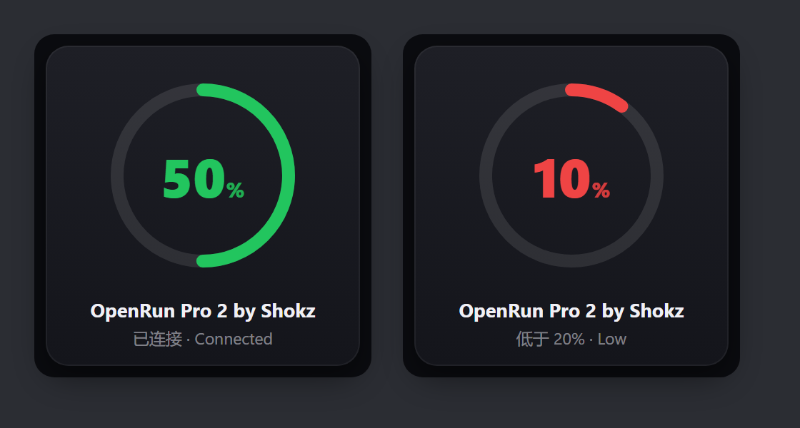
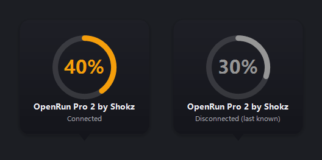
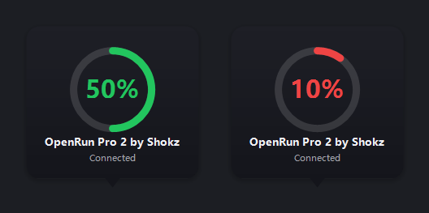

# 蓝牙电量环 · Bluetooth Battery Ring

> [中文](README.md) | English

> Chrome extension + Windows system-tray battery icon

A small tool that shows your **Bluetooth headset** battery (works with Shokz and most Bluetooth headsets), in two ways:

- **Chrome extension**: the toolbar icon is a battery ring (green normally, **red below 20%**); the **percentage shows on hover**, and **clicking** opens a big panel with the **exact headset model + battery percentage**.
- **Windows tray icon**: a ring in the notification area; hover for the percentage, **left-click** for the same big panel (model + percentage).
- **Real connection state**: when the headset is disconnected/charging, the ring turns **gray with "Disconnected (last known)"** and keeps the battery at disconnect; on reconnect it resumes live values and colours automatically.

The level is read from the **value Windows itself keeps and shows under Settings → Bluetooth** (the PnP property `DEVPKEY_Bluetooth_Battery`), so it always matches the OS, in 10% steps. Connection state comes from WinRT `BluetoothDevice.ConnectionStatus`.

**Chrome popup (latest):**



**Connected / disconnected (40% connected = amber; 30% disconnected = gray + last level):**



**Windows tray bubble (latest):**



---

## One-click install (recommended)

1. Download **`BluetoothBatterySetup.exe`** from [Releases](../../releases) and run it.
2. It automatically: extracts to `%LOCALAPPDATA%\ShokzBattery`, registers the native reader, starts the tray icon and enables auto-start, and opens `chrome://extensions`.
3. In the opened `chrome://extensions`: enable **Developer mode** → **Load unpacked** → pick the `extension` folder it shows.

> Why the manual step for the extension? Chrome does not allow a normal program to install an extension silently; you must click "Load unpacked" once. The tray part is fully automatic.

---

## Manual install (without the installer)

```
extension\       <- Chrome extension (load this folder)
native-host\     <- native reader (host.exe + status.ps1)
tray\            <- tray battery icon (tray.exe + status.ps1)
setup.ps1        <- manual one-click script (register host + start tray + autostart)
一键安装.cmd      <- shortcut to setup.ps1
```

1. Run **`一键安装.cmd`** (registers the native reader, starts the tray, enables auto-start, opens the extensions page).
2. In `chrome://extensions`: Developer mode → Load unpacked → choose the `extension` folder.

---

## How it works

- A Chrome extension cannot read system Bluetooth directly, so it calls the local `host.exe` via **Native Messaging**;
- `host.exe` runs `status.ps1`, which reads the PnP property **`DEVPKEY_Bluetooth_Battery`**
  (`{104EA319-6EE2-4701-BD47-8DDBF425BBE5} 2`, attached to the headset's `Hands-Free AG` node);
- This is exactly the value Windows Settings shows, in 10% steps, refreshed when the headset reports;
- The tray icon `tray.exe` reuses the same `status.ps1` and refreshes every 60 seconds.

> Note: the headset's private SPP/GAIA frames, BLE GATT `0x180F`, and `System.Devices.BatteryLife` all fail to return this device's real battery; only the PnP property above is reliable.

---

## Build from source

Requires the .NET Framework `csc.exe` that ships with Windows.

```powershell
powershell -File native-host\build.ps1   # native reader
powershell -File tray\build.ps1           # tray icon
powershell -File installer\build.ps1      # single-file installer (bundles extension + native-host + tray)
```

The extension ID is pinned by the `key` in `extension\manifest.json` (`pfggfahekjpdogphkccembookkehgjpi`);
the native host `allowed_origins` matches it. If you regenerate the key, update `ExtId` in `installer\installer.cs` and `setup.ps1`.

---

## Layout

```
├─ extension\            Chrome extension (MV3, zh/en via _locales)
│  ├─ manifest.json
│  ├─ popup.html / popup.js / background.js
│  ├─ _locales\ (en, zh_CN)
│  └─ icons\
├─ native-host\          Native Messaging host (C#, reads PnP battery)
├─ tray\                 Windows tray battery icon (C# WinForms, zh/en)
├─ installer\            single-file installer (C#, embeds payload)
├─ setup.ps1 / 一键安装.cmd
└─ preview.png
```

## Notes & limitations

- The level is the OS value in **10% steps**: it stays constant until the next step, same as Windows Settings (not stuck).
- Browser security means the extension has to be "Load unpacked" once; the installer automates everything else.
- Switching headsets: edit `$DeviceName` at the top of `native-host\status.ps1` (the device must show a battery in Windows Bluetooth settings).

## License

MIT (see LICENSE).
