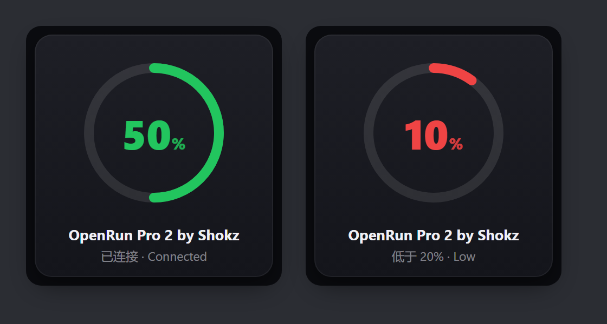
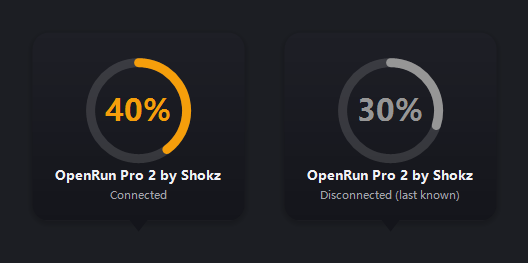
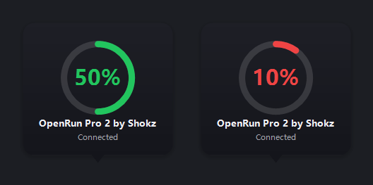

# 蓝牙电量环 · Bluetooth Battery Ring

> 中文 | [English](README.en.md)

> Chrome 插件 + Windows 任务栏电量图标

一个显示 **蓝牙耳机** 电量的小工具（兼容韶音 Shokz 及大多数蓝牙耳机），两种用法：

- **Chrome 插件**：工具栏图标是一个电量环（正常绿色、**低于 20% 变红**）；**鼠标悬停**显示百分比，**点击**弹出大面板，显示**准确的耳机型号 + 电量百分比**。
- **Windows 任务栏图标**：通知区一个电量环；悬停显示百分比，**左键点击**同样弹出大面板（型号 + 百分比）。
- **连接状态真实反映**：耳机断开/充电时显示为**灰色环 + 「已断开（显示上次电量）」**并保留断开时的电量；重新连接后自动恢复实时电量与颜色。

电量读取的是 **Windows 自己维护、并在「设置 → 蓝牙」里显示的那个值**（PnP 属性 `DEVPKEY_Bluetooth_Battery`），所以和系统设置页永远一致，按 10% 档更新。连接状态由 WinRT `BluetoothDevice.ConnectionStatus` 实时判断。

**Chrome 弹窗（最新）：**



**连接 / 断开两态（40% 已连接 = 琥珀；30% 已断开 = 灰环 + 上次电量）：**



**Windows 任务栏气泡（最新）：**



---

## 一键安装（推荐）

1. 到 [Releases](../../releases) 下载 **`BluetoothBatterySetup.exe`**，双击运行。
2. 它会自动：解压到 `%LOCALAPPDATA%\ShokzBattery`、注册本机读取程序、启动任务栏电量图标并设为开机自启、打开 `chrome://extensions`。
3. 在弹出的完成提示里，按提示在 `chrome://extensions` 里：开「开发者模式」→「加载已解压的扩展程序」→ 选择它给出的 `extension` 文件夹。

> 为什么插件那一步要手动？Chrome 出于安全不允许普通程序静默安装扩展，必须你在扩展页点一次「加载已解压」。任务栏图标部分是全自动的。

---

## 手动安装（不使用安装器）

```
extension\       ← Chrome 扩展（加载这个文件夹）
native-host\     ← 本机读取程序（host.exe + status.ps1）
tray\            ← 任务栏电量图标（tray.exe + status.ps1）
setup.ps1        ← 手动一键脚本（注册 native host + 启动托盘 + 自启）
一键安装.cmd      ← setup.ps1 的快捷入口
```

1. 双击 **`一键安装.cmd`**（注册本机读取程序、启动托盘、设开机自启、打开扩展页）。
2. 在 `chrome://extensions` 里「开发者模式 → 加载已解压 → 选 `extension` 文件夹」。

---

## 工作原理

- Chrome 插件无法直接读系统蓝牙，所以通过 **Native Messaging** 调用本机 `host.exe`；
- `host.exe` 运行 `status.ps1`，读取 PnP 属性 **`DEVPKEY_Bluetooth_Battery`**
  （`{104EA319-6EE2-4701-BD47-8DDBF425BBE5} 2`，挂在耳机的 `Hands-Free AG` 节点上）；
- 这正是 Windows 蓝牙设置页显示的电量，10% 一档，耳机上报时刷新；
- 任务栏图标 `tray.exe` 复用同一个 `status.ps1`，每 60 秒刷新一次。

> 踩坑记录：耳机的私有 SPP/GAIA 帧、BLE GATT `0x180F`、`System.Devices.BatteryLife` 都取不到这台设备的真实电量；唯一可靠的是上面的 PnP 属性。

---

## 开发与构建

需要 Windows 自带的 .NET Framework（内含 `csc.exe`）。

```powershell
# 本机读取程序
powershell -File native-host\build.ps1

# 任务栏图标
powershell -File tray\build.ps1

# 单文件安装器（把 extension/native-host/tray 打进 exe）
powershell -File installer\build.ps1
```

扩展 ID 由 `extension\manifest.json` 里的 `key` 固定（`pfggfahekjpdogphkccembookkehgjpi`），
`native-host` 的 `allowed_origins` 与之对应。若重新生成 key，需同步更新 `installer\installer.cs` 里的 `ExtId` 与 `setup.ps1`。

---

## 目录结构

```
├─ extension\            Chrome 扩展（MV3）
│  ├─ manifest.json
│  ├─ popup.html / popup.js / background.js
│  └─ icons\
├─ native-host\          Native Messaging 主机（C#，读 PnP 电量）
│  ├─ host.cs / host.exe / status.ps1 / build.ps1
├─ tray\                 Windows 任务栏电量图标（C# WinForms）
│  ├─ tray.cs / tray.exe / status.ps1 / build.ps1
├─ installer\            单文件安装器（C#，内含 payload）
│  ├─ installer.cs / BluetoothBatterySetup.exe / build.ps1
├─ setup.ps1 / 一键安装.cmd
└─ preview.png
```

## 说明与限制

- 电量读的是系统值，**10% 一档**：数值没跨档时会保持不变，与系统设置页一致（不是卡死）。
- 浏览器安全策略决定了插件必须手动「加载已解压」一次，安装器已把其余步骤全自动化。
- 换耳机：修改 `native-host\status.ps1` 顶部 `$DeviceName` 为新设备名（该设备需在 Windows 蓝牙设置里能看到电量）。

## 许可

MIT（见 LICENSE）。
